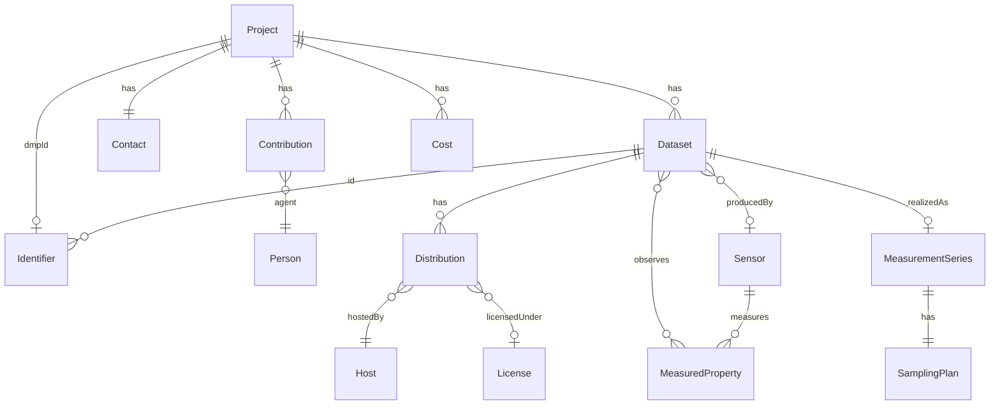

# 04_P04_S04 — EDO internes Format (Spezifikation, Draft v0.1)

> Card CF1-006 · Fragment `04_Internes_Format_Beschreibung`
> Status: **draft v0.2 — Entscheidungen 2026-11-19 eingearbeitet** · 2026-11-19

Zwischenschicht zwischen den Quellen (DMP via RDMO, SMS) und den Zielformaten
(RO-Crate / JSON-LD / RDF-star Graph, OEP). Ziel: alle relevanten Informationen
der Quellen in **einer** normalisierten Struktur mit **definiertem Vokabular**
aufnehmen, so dass die Transformationen nach CF2 deterministisch werden.

---

## 1. Anforderungen

| # | Anforderung | Herkunft |
|---|---|---|
| R1 | Projektebene abdecken: Titel, Beschreibung, Zeitrahmen, Kontakt, Beiträger, Förderer, Kosten, DMP-ID, Sprache | maDMP-Export-Mapping (`scripts/dmp/03_P03_S03_madmp-export.mapping.yaml`), Abschnitt `dmp:` |
| R2 | Datensatzebene abdecken: ID, Titel, Beschreibung, Typ, issued, keywords, personal/sensitive data, Qualitätsmaßnahmen, Distributionen (während/nach Projekt: Host, access_url, data_access, Lizenz + Startdatum, zertifiziert, PID-System) | Mapping, Abschnitt `dataset:` |
| R3 | Instrumentenebene abdecken: Gerät (Name, Typ, Hersteller, Modell, PID), Messgrößen (CV-URI, Einheit, Messbereich, Genauigkeit, Auflösung, Sampling Media, Compartment) | SMS device 67 + device properties 157–161 (`scripts/sms/`) |
| R4 | Szenario-/Messreihenebene: Sampling-Intervall, Zeitfenster, Verknüpfung Datensatz ↔ Sensor | CF1-003 (15 min, 2026-07-01 … 2026-09-30) — in **keiner** Quelle maschinell abgelegt (Lücke, siehe §6) |
| R5 | Verknüpfungen als First-Class-Entities (nicht Text): dataset↔distribution↔host, dataset↔person+role, project↔dataset, dataset↔sensor | CF1-006 Überlegungen; Lektion aus maDMP-Walkthrough (Group 6: unverbundene Freitextwerte) |
| R6 | Erweiterbar für High-Level-Beispiel (Projektantrag, weitere Quellen ELN/SMS-Instanzen) | Fragment 12 |
| R7 | Direkt in ein Graphmodell übersetzbar (RDF-star: statement-level Metadaten für Provenienz der Transformationen) | Card CF1-006 Business Context |
| R8 | Vokabular definiert: Klassen, Properties, Datentypen, kontrollierte Vokabulare mit Quellen-URIs | Card AC „Fields, types, entity relationships" + Nutzerangabe |

## 2. Entitätsmodell



Entitäten:

- **Project** — aus R1
- **Person / Contact / Contribution** — Contact = Person ohne Rolle am Project;
  Contribution = Person + Rolle (maDMP `contributor` mit `role_template`)
- **Cost** — Titel + Wert (+ Currency, CF1-008 offen)
- **Identifier** — typed identifier (dmp_id, dataset_id, sensor PID); Typ aus
  kontrolliertem Vokabular (doi, handle, urn, url, other …)
- **Dataset** — aus R2
- **Distribution** — Titel, access_url, data_access (open/shared/closed),
  formats[], certified_with[], pid_system, license_ref, license_start_date
- **Host** — Titel/URI des Repositories/Storage
- **Sensor** — aus R3 (SMS device)
- **MeasuredProperty** — aus R3 (SMS device property)
- **MeasurementSeries** + **SamplingPlan** — aus R4 (neu, keine Quelle; Lücke)

## 3. Vokabular

### 3.1 Namespaces

| Präfix | IRI | Verwendung |
|---|---|---|
| `edo` | `https://w3id.org/edo/terms/` | eigene Klassen/Properties (neu gemünzt) |
| `dcterms` | `http://purl.org/dc/terms/` | Titel, Beschreibung, issued, Sprache |
| `dcat` | `http://www.w3.org/ns/dcat#` | Dataset, Distribution, accessURL, mediaType |
| `foaf` | `http://xmlns.com/foaf/0.1/` | Person (name, mbox) |
| `prov` | `http://www.w3.org/ns/prov#` | Attribution (contributions), Sensor-Erzeugung |
| `time` | `http://www.w3.org/2006/time#` | Zeitintervalle (Zeitrahmen) |
| `sosa` | `http://www.w3.org/ns/sosa/` | Sensor, observes, MeasurementSeries |
| `smscv` | `https://sms-cv.helmholtz.cloud/sms/cv/api/v1/` | **wiederverwendete** SMS-CV-URIs (measured quantities, units, equipment types, sampling media, compartments) |
| `madmp` | `https://w3id.org/maDMP/` (RDA maDMP CV) | data_access, pid_system, certified_with, funder id types |
| `xsd` | `http://www.w3.org/2001/XMLSchema#` | Datentypen |

**Grundprinzip:** existierende Vokabular-URIs werden **wiederverwendet** statt
neu gemünzt (Lesson aus CF1-004: Option-Maps übersetzen lokal in CV-Terme —
das interne Format behält die CV-Term-Ebene, nicht die RDMO-Options-Ebene).
Neue URIs nur für EDO-spezifische Konzepte (MeasurementSeries, SamplingPlan,
Contribution, Kostenzuordnung).

### 3.2 Klassen

| Klasse | IRI (Vorschlag) | Quelle | Properties (→ Datentyp) |
|---|---|---|---|
| Project | `edo:Project` | maDMP `dmp` + `dmp/project` | `dcterms:title` (xsd:string), `dcterms:description` (xsd:string), `time:hasInterval` → Interval (xsd:date ×2), `dcterms:language` (BCP-47, CV), `edo:dmpId` → Identifier, `edo:hasContact` → Person, `edo:hasContribution` → Contribution, `edo:hasCost` → Cost |
| Person | `foaf:Person` | maDMP `contact`/`contributor` | `foaf:name` (xsd:string), `foaf:mbox` (xsd:anyURI), `edo:identifier` → Identifier (ORCID etc., CV `person_id_type`) |
| Contribution | `prov:Attribution`-Spezialisierung `edo:Contribution` | maDMP contributor + `role_template` | `prov:agent` → Person, `dcterms:type` → Rolle (RDA maDMP contributor-type CV, §3.3) |
| Cost | `edo:Cost` | maDMP `dmp/cost` | `dcterms:title` (xsd:string), `edo:value` (xsd:decimal, nullable), `edo:currency` (ISO-4217, CV) |
| Identifier | `edo:Identifier` | dmp_id, dataset_id, SMS PID | `dcterms:identifier` (xsd:string), `dcterms:type` (CV: doi/handle/urn/url/other) |
| Dataset | `dcat:Dataset` | maDMP `dmp/dataset` | `dcterms:title`, `dcterms:description`, `dcterms:issued` (xsd:date), `dcterms:type` (xsd:string, v0.1), `dcat:keyword` (xsd:string ×n), `edo:personalData` (xsd:boolean), `edo:sensitiveData` (xsd:boolean), `edo:qualityAssurance` (xsd:string ×n), `edo:preservationStatement` (xsd:string), `dcat:distribution` → Distribution, `edo:identifier` → Identifier, `sosa:observes` → MeasuredProperty, `prov:wasGeneratedBy` → Sensor |
| Distribution | `dcat:Distribution` | maDMP `dmp/dataset/distribution` | `dcterms:title`, `dcat:accessURL` (xsd:anyURI), `edo:dataAccess` (CV: open/shared/closed), `dcat:format` (IANA Media Type ×n, §3.3), `edo:certifiedWith` (CV), `edo:pidSystem` (CV), `edo:license` → License, `dcterms:issued` als license_start_date |
| License | `dcterms:LicenseDocument` | maDMP `license_ref` | `dcterms:license` (xsd:anyURI), `time:hasBeginning` (license_start_date) |
| Host | `edo:Host` | maDMP `host` / `access_url` | `dcterms:title` (xsd:string), `edo:url` (xsd:anyURI, nullable) |
| Sensor | `sosa:Sensor` | SMS device | `dcterms:title` (SMS short_name), `edo:model` (xsd:string), `edo:manufacturer` (xsd:string), `dcterms:type` → SMS-CV equipment type URI, `edo:identifier` → Identifier (Handle/PID), `sosa:observes` → MeasuredProperty |
| MeasuredProperty | `sosa:ObservableProperty` | SMS device property | `dcterms:title` (CV property_name), `smscv:` property URI, `edo:unit` → SMS-CV unit URI, `edo:measuringRangeMin/Max` (xsd:decimal), `edo:accuracy` (xsd:string, v0.1 — „±0.3 K @ 25 °C"), `edo:resolution` (xsd:decimal + unit), `smscv:` sampling media / compartment URI, `edo:aggregationType` → SMS-CV URI |
| MeasurementSeries | `edo:MeasurementSeries` | neu (R4) | `dcterms:title` (z.B. „Weatherstation Q3-2026"), `time:hasInterval` → Interval, `edo:hasSamplingPlan` → SamplingPlan, `prov:wasGeneratedBy` → Sensor |
| SamplingPlan | `edo:SamplingPlan` | neu (R4) | `edo:samplingInterval` (xsd:duration, ISO-8601 „PT15M"), `edo:samplingMedia` → SMS-CV URI |

### 3.3 Kontrollierte Vokabulare (CVs)

| CV | Quelle | Werte (aus Mapping/Instanz) |
|---|---|---|
| data_access | RDA maDMP | `open`, `shared`, `closed` |
| pid/dmp/dataset id type | RDA maDMP | `doi`, `handle`, `ark`, `urn`, `url`, `other` |
| certified_with | RDA maDMP | `din31644`, `dini-zertifikat`, `dsa`, `iso16363`, `iso16919`, `trac`, `wds`, `coretrustseal` |
| funder id type | RDA maDMP | `fundref`, `url`, `other` |
| language | ISO-639-3 | `eng`, `deu` |
| currency | ISO-4217 | (Liste im Mapping) |
| Measured quantities, units, equipment types, sampling media, compartments, aggregation types | **SMS CV** (`smscv:`) — URIs unverändert übernommen | z.B. Air temperature `.../measuredquantities/4/`, °C `.../units/51/` |
| Rolle (Contribution) | **RDA maDMP contributor-type CV** (DataCite contributor types; CRediT als spätere Verfeinerung möglich) — Entscheidung 2026-11-19 | `Contact Person`, `Data Collector`, `Data Curator`, `Data Manager`, `Distributor`, `Editor`, `Hosting Institution`, `Producer`, `Project Leader`, `Project Member`, `Project Manager`, `Related Person`, `Researcher`, `Research Group`, `Rights Holder`, `Sponsor`, `Supervisor`, `Work Package Leader`, `Other` |
| Formats (`dcat:format`) | **IANA Media Types** — Entscheidung 2026-11-19; als **IRI** repräsentiert (``http://purl.org/NET/mediatypes/<type>``, z.B. ``http://purl.org/NET/mediatypes/text/csv``) — F5 | `text/csv`, `application/json`, … (Freitext „CSV“ wird in der Transformation CF2-003 per Mapping-Tabelle übersetzt) |

## 4. Beispiel-Instanz (Weatherstation-Szenario, DMP + SMS)

> **Harmonisiert 2026-11-19 (F3/F5):** Die example in `json` folgt der
> Realisation (Catalogue P1; `trip.py`/`agnostic_trip.py`) und nicht dem
> DMP-Dokumententitel: `dcterms:title` trägt die **Project** title
> (`project/title` = „Measurement_02“), **nicht** den DMP-Dokumententitel
> (`dmp/title` = „maDMP for Measurement_02“ — eine separate, in CF2-003 nicht
> abgebildete Ebene). Ebenso ist `dcat:format` als **IRI** (Media-Type-IRI
> `http://purl.org/NET/mediatypes/<type>`) dargestellt, nicht als
> Freitext-Zeichenkette (vgl. §3.3 und F5).
>

```json
{
  "@context": {
    "edo": "https://w3id.org/edo/terms/",
    "dcterms": "http://purl.org/dc/terms/",
    "dcat": "http://www.w3.org/ns/dcat#",
    "foaf": "http://xmlns.com/foaf/0.1/",
    "prov": "http://www.w3.org/ns/prov#",
    "sosa": "http://www.w3.org/ns/sosa/",
    "smscv": "https://sms-cv.helmholtz.cloud/sms/cv/api/v1/"
  },
  "@id": "urn:uuid:<uuid5 rdmo:project:6>",
  "@type": "edo:Project",
  "dcterms:title": "Measurement_02",
  "dcterms:language": "eng",
  "time:hasInterval": { "begin": "2026-07-01", "end": "2026-09-11" },
  "edo:hasContact": {
    "@type": "foaf:Person",
    "foaf:name": "A. Koubaa",
    "foaf:mbox": "mailto:mohamed-anis.koubaa@kit.edu"
  },
  "edo:hasContribution": [
    { "@type": "edo:Contribution", "prov:agent": {"foaf:name": "A. Koubaa"},
      "dcterms:type": "Data Curator" },
    { "@type": "edo:Contribution", "prov:agent": {"foaf:name": "A. Koubaa"},
      "dcterms:type": "Data Curator" }
  ],
  "dcat:dataset": {
    "@id": "edo:dataset:weatherstation-q3-2026",
    "@type": "dcat:Dataset",
    "dcterms:title": "Weatherstation Q3-2026",
    "dcterms:description": "The data are collected from the sensor with the PIDINST: 21.11157/9b6cdfb9-a4fb-4269-af04-1ef94588f5a8. Data are continuously generated",
    "dcat:keyword": ["Energy", "Orchestrator"],
    "edo:personalData": false,
    "edo:sensitiveData": false,
    "edo:qualityAssurance": [],
    "dcat:distribution": [
      { "@type": "dcat:Distribution",
        "dcterms:title": "Storage during the project",
        "dcat:accessURL": "https://gitlab.kit.edu/kit/iai/it4edm/metadb",
        "edo:dataAccess": "open",
        "dcat:format": ["http://purl.org/NET/mediatypes/text/csv"] },
      { "@type": "dcat:Distribution",
        "dcterms:title": "Preservation after the project",
        "edo:dataAccess": "open",
        "edo:license": {"dcterms:license": "https://creativecommons.org/licenses/by/4.0/",
                        "time:hasBeginning": "2027-01-29"} }
    ],
    "prov:wasGeneratedBy": {
      "@type": "sosa:Sensor",
      "@id": "https://sms.atmohub.kit.edu/devices/67",
      "dcterms:title": "KIT-CN-IAI-Bau445-Weather-Station-Weatherstation",
      "edo:model": "FS6002",
      "edo:manufacturer": "FuehlerSysteme eNET International GmbH",
      "dcterms:type": "smscv:equipmenttypes/54/",
      "edo:identifier": {"dcterms:identifier": "21.11157/9b6cdfb9-a4fb-4269-af04-1ef94588f5a8",
                         "dcterms:type": "handle"},
      "sosa:observes": {
        "@type": "sosa:ObservableProperty",
        "smscv:measuredQuantity": "smscv:measuredquantities/4/",
        "dcterms:title": "Air temperature",
        "edo:unit": "smscv:units/51/",
        "edo:measuringRangeMin": -40.0,
        "edo:measuringRangeMax": 80.0,
        "edo:accuracy": "±0.3 K @ 25 °C; ±1.0 K over -40…+80 °C",
        "edo:resolution": 0.1
      }
    },
    "edo:realizedAs": {
      "@type": "edo:MeasurementSeries",
      "dcterms:title": "Weatherstation Q3-2026",
      "time:hasInterval": { "begin": "2026-07-01", "end": "2026-09-30" },
      "edo:hasSamplingPlan": {
        "@type": "edo:SamplingPlan",
        "edo:samplingInterval": "PT15M",
        "edo:samplingMedia": "smscv:samplingmedia/9/"
      }
    }
  }
}
```

## 5. RDF-star-Bezug (R7)

Jede erzeugte Property-Aussage kann als `<< s p o >>` Triple referenzierbar
gemacht werden, um Transformations-Provenienz anzubinden:
`<< <dataset> dcterms:title "Weatherstation Q3-2026" >> prov:wasDerivedFrom
<rdmo:project:6/attribute:project/dataset/id> ; prov:generatedAtTime "…" .`
Das bleibt v0.1 als Ausblick; konkret wird es in CF2-003 (Transformationen).

## 6. Offene Punkte / Lücken

**Entschieden 2026-11-19 (v0.2):**

1. **Rolle (Contribution):** RDA maDMP contributor-type CV übernommen (§3.3);
   die Übersetzung der heutigen `role_template`-Freitexte („Responsible for
   preservation“ → `Data Curator` …) gehört in die Transformations-Mapping-
   Tabelle (CF2-003).
2. **Formats:** IANA Media Types (`text/csv` statt „CSV“); Übersetzung des
   Freitexts aus RDMO ebenfalls CF2-003.
3. **Serialisierung:** JSON-LD-kompatibles JSON (wie §4); CF1-007 leitet daraus
   das LinkML-Schema ab.
4. **Quelle für Sampling-Intervall & Messreihen-Zeitfenster (R4):** RDMO-Fragen
   wären der bevorzugte Weg — der Standardkatalog ist unveränderlich, daher
   Register-Eintrag **#16/#17** in `scripts/dmp/05_P05_S05_madmp-catalog-gaps.md`
   (Lücke getragen); alternativ Quelle: **ELN**. Bis dahin manuelle Versorgung
   auf der EDO-Ebene.

**Weiter offen:**

5. **Dataset↔Sensor-Verknüpfung** ist heute nur im Freitext der
   `dataset/description` („PIDINST: …“). Maschinelle Kopplung fehlt —
   **2026-11-19 als Register-Eintrag #18 aufgenommen**; wie #16/#17 werden die
   Katalog-Lücken zusammengefasst in **CF2-001** (Entwicklung eines neuen
   Katalogs/Fragebogens für RDMO) und **CF2-002** behandelt.
6. **IRI-Policy**: `edo:` Platzhalter-Namespace; echte IRIs erst bei CF1-007
   (LinkML-Schema) fixieren.
7. **Datenblatt-Diskrepanz SMS** (Messbereich −80…60 vs. Datenblatt −40…+80):
   internes Format folgt dem Datenblatt (siehe CF1-005).
8. **`dcterms:type` der Contribution**: URI-Form der CV-Werte (DataCite-IRIs
   oder maDMP-CV-Strings) — bei CF1-007 fixieren.
