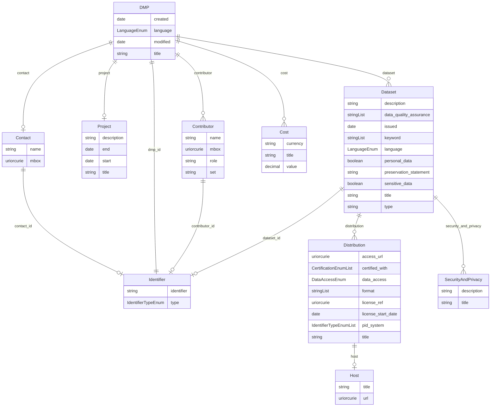
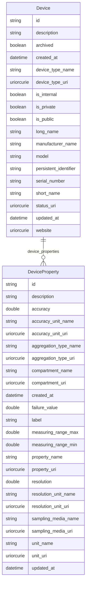
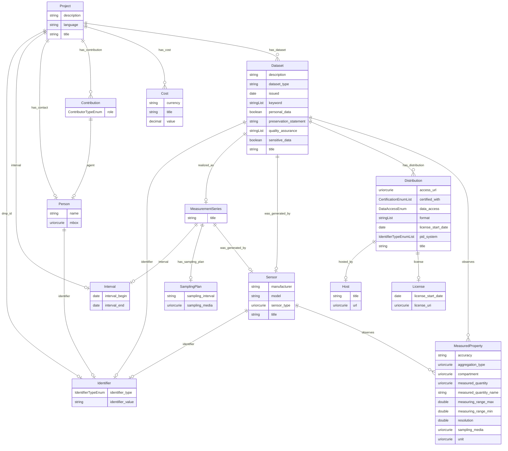

# 05_P05_S05 — LinkML-Diagramme (CF1-007)

Status: ✅
Datum: 2026-11-19

Mermaid-ER-Diagramme der drei LinkML-Schemas (Klassen mit Slots/Ranges, Beziehungen mit Kardinalitäten). Die `.mmd`-Dateien liegen daneben; die Diagramme unten rendern direkt in Obsidian.

## DMP-Schema (`05_P05_S05_madmp-schema.yaml`, 10 Klassen)



## SMS-Schema (`05_P05_S05_sms-schema.yaml`, 2 Klassen)



## Internes-Format-Schema (`05_P05_S05_internal-format-schema.yaml`, 14 Klassen)



## Regenerierung

```sh
cd projecting_spaces/EDO/Artefacts/07_Fragments/scripts/linkml
PY=/Users/ot2661/Documents/01_dev/edo/.venv/bin/python3
for s in madmp sms internal-format; do
  PYTHONPATH=/tmp/linkmllib $PY -m linkml.generators.erdiagramgen "05_P05_S05_${s}-schema.yaml" > "05_P05_S05_${s}-erd.mmd"
done
```

Pro-Klassen-Diagramme (eine Mermaid-Datei je Klasse):

```sh
PYTHONPATH=/tmp/linkmllib $PY -m linkml.generators.mermaidclassdiagramgen -d /tmp/mmout <schema>.yaml
```

Graphviz-Variante (veraltet, rendert direkt via `dot`, hängt die Format-Endung an `-o` an):

```sh
PYTHONPATH=/tmp/linkmllib $PY -m linkml.generators.dotgen <schema>.yaml -o <name> -f dot
dot -Tsvg <name>.dot -o <name>.svg
```

Hinweis: `range: Any` ist ohne eigene `Any`-Klasse kein gültiger Range — `erdiagramgen`/`dotgen` brechen mit „unrecognized range (Any)“ ab, während `jsonschemagen` stillschweigend durchläuft. URI-artige Felder stehen deshalb auf `uriorcurie` (siehe Modellentscheidungen §5).
